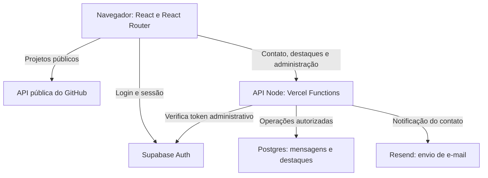

# Decisões de engenharia — CP3 Portfólio

Este documento registra as escolhas do projeto e as alternativas consideradas. Os critérios são adequação ao enunciado, facilidade de compreender e explicar o código, quantidade de configuração e manutenção. Não houve benchmark comparativo entre as alternativas; as concessões abaixo são uma análise de arquitetura.

**Fonte dos requisitos:** prints do enunciado “CP3 — Portfolio — Stack e Harness Engineering” enviados pelo aluno. A página de origem é o [Notion do professor](https://cherry-client-b8f.notion.site/CP3-Portfolio-Stack-e-Harness-Engeneering-3fe911d84e0d80f7bb6dec712e6d904a?pvs=74). O enunciado foi lido nos prints, não por acesso bem-sucedido ao link.

**Verificação:** decisões e critérios não são comprovantes de execução. Resultados de testes, links publicados e nota do Lighthouse devem ser registrados somente depois de obtidos, conforme [CHECKLIST-ENTREGA.md](./CHECKLIST-ENTREGA.md).

## 1. Visão da arquitetura

O projeto usa React com JavaScript, desenvolvido e compilado com Vite. React Router organiza as páginas. Os repositórios públicos de `PhAngueira` são consultados na API do GitHub. Supabase oferece autenticação e Postgres; operações de dados da aplicação passam pela API Node executada em Vercel Functions. Resend participa do envio de e-mail pelo servidor.

As rotas públicas de contato e consulta de destaques atendem visitantes. As operações administrativas exigem token válido e conferência do ID do proprietário no servidor. A validação no navegador melhora a experiência; a API também valida os dados recebidos.

### Responsabilidades no código

| Área                              | Responsabilidade                                                                   |
| --------------------------------- | ---------------------------------------------------------------------------------- |
| `pages`                           | Montar as páginas e relacioná-las às rotas.                                        |
| `components`                      | Apresentar elementos reutilizáveis, como botões, cards e avisos.                   |
| `services`                        | Centralizar comunicação com GitHub e API da aplicação.                             |
| `hooks`                           | Reutilizar a lógica de estado e carregamento quando necessário.                    |
| API Node                          | Validar entradas, autenticar o proprietário, acessar o banco e enviar e-mail.      |
| Testes                            | Verificar comportamentos observáveis, especialmente formulário e acesso protegido. |
| Documentação e instruções para IA | Registrar decisões, convenções e critérios de aceitação.                           |

Os nomes acima indicam as responsabilidades a mostrar no vídeo. Confira os caminhos existentes no pacote antes da gravação. Componentes seguem PascalCase; hooks personalizados começam com `use`; funções e variáveis recebem nomes descritivos. As chamadas de rede ficam fora dos componentes puramente visuais.

## 2. Comparação das escolhas

| Decisão                                                 | Alternativas consideradas                                        | Critério e concessão                                                                                                                                                                                                           |
| ------------------------------------------------------- | ---------------------------------------------------------------- | ------------------------------------------------------------------------------------------------------------------------------------------------------------------------------------------------------------------------------ |
| React + Vite                                            | React em um framework como Next.js; configuração manual do build | React é exigido pelo enunciado. Vite mantém explícita a separação entre interface e API e atende uma aplicação cliente. Aceitamos configurar as rotas no deploy e não utilizar renderização no servidor.                       |
| JavaScript                                              | TypeScript                                                       | Prioridade em compreender e apresentar o código no primeiro ano. Aceitamos não ter a checagem estática de tipos do TypeScript; validações, lint e testes continuam necessários.                                                |
| React Router                                            | TanStack Router; Next.js com rotas por arquivos                  | Precisamos de URLs individuais, página 404 e rotas protegidas. React Router atende esse escopo sem alterar a estrutura para um framework completo. Aceitamos manter a declaração das rotas.                                    |
| CSS puro                                                | Tailwind; biblioteca pronta de componentes                       | Facilita explicar seletores, responsividade e identidade visual. Aceitamos escrever e manter os estilos e os componentes visuais.                                                                                              |
| `fetch` e cache em módulo por 5 minutos                 | Axios; TanStack Query; SWR                                       | O projeto tem poucas fontes de dados. Usamos a API nativa de requisições e um cache pequeno, explícito. Aceitamos implementar expiração, estados e tratamento de erros em vez de receber recursos avançados de uma biblioteca. |
| Hooks do React e estado compartilhado quando necessário | Redux Toolkit; Zustand                                           | O estado da interface é limitado. Evitamos uma estrutura global maior sem necessidade demonstrada. Aceitamos organizar cuidadosamente o compartilhamento de sessão, tema e dados.                                              |
| Supabase Auth + Postgres                                | Firebase; autenticação e banco próprios                          | Precisamos de login e dados persistentes relacionados a mensagens e destaques. Aceitamos a configuração de um serviço externo, suas credenciais e suas políticas de acesso.                                                    |
| API Node em Vercel Functions                            | Servidor Node separado; operações diretas do cliente no banco    | Permite validar acesso, manter segredos no servidor e publicar a API com o projeto. Aceitamos as características do ambiente de Functions e sua configuração de deploy.                                                        |
| Resend pelo servidor, com idempotência                  | EmailJS; Formspree; outro provedor de e-mail transacional        | O contato precisa integrar envio de e-mail e registro no dashboard. Mantemos essa coordenação na API. Aceitamos configurar remetente/conta autorizados e tratar falhas do provedor.                                            |
| Vitest + Testing Library                                | Playwright; testes somente manuais                               | Foco inicial nos comportamentos obrigatórios do formulário e do acesso protegido. Aceitamos que esses testes não substituem a verificação do site publicado e das integrações reais.                                           |
| ESLint + Prettier, hooks e GitHub Actions               | Biome; revisão somente manual                                    | Separação clara entre análise de código, formatação e verificações automatizadas. Aceitamos mais arquivos de configuração e manutenção do fluxo.                                                                               |
| Vercel e integração com GitHub                          | Netlify; hospedagem de servidor próprio                          | A seção de entrega pede expressamente um link da Vercel. Aceitamos configurar variáveis, integração com o repositório e comportamento das URLs.                                                                                |

## 3. Dados do GitHub e navegação

Os projetos vêm da API pública do GitHub do usuário [PhAngueira](https://github.com/PhAngueira). Descrição, linguagem e atualização são dados dos repositórios. A escolha de destaques seleciona projetos vindos dessa fonte; ela não substitui a consulta por uma lista manual de cards.

O cache em módulo tem validade de **5 minutos**. Enquanto a entrada estiver válida, a navegação pode reutilizar o resultado. O código também deve evitar consultas simultâneas redundantes para o mesmo recurso. Depois da expiração, uma nova consulta é esperada. Recarregar completamente a página reinicia o estado em memória; o cache não é apresentado como armazenamento permanente.

Essa solução é suficiente para o escopo previsto, mas exige cuidados que uma biblioteca especializada ajudaria a administrar: expiração, erro, reutilização de requisições em andamento e comportamento entre componentes. Não são usadas credenciais secretas do GitHub no navegador.

Cada projeto tem uma URL individual. Uma rota desconhecida mostra uma página 404; falha de rede ou limite da API mostra um estado de erro com uma ação de recuperação. Uma resposta válida sem projetos mostra o estado de lista vazia. São situações diferentes e não devem ser tratadas como o mesmo resultado.

## 4. Contato, autenticação e autorização

### Contato

O formulário valida campos individualmente e bloqueia o envio enquanto aguarda a resposta. A API repete as validações, registra a mensagem e coordena o e-mail ao proprietário.

Há duas evidências a verificar: a mensagem disponível no dashboard e o e-mail recebido. Aceitação de uma requisição pelo provedor não deve ser confundida com comprovação de entrega na caixa de entrada.

A idempotência associa tentativas do mesmo envio à mesma operação. A intenção é permitir recuperação após uma falha de rede sem criar registros ou notificações duplicados. Não basta desabilitar o botão: uma pessoa pode atualizar a página ou repetir uma requisição. A implementação deve combinar o controle da aplicação com o identificador de idempotência utilizado no envio pelo provedor.

Se o banco registrar a mensagem e o envio de e-mail falhar, a aplicação precisa comunicar corretamente a falha, preservar a possibilidade de recuperação e evitar criar outra mensagem ao tentar novamente. Não se deve mostrar sucesso completo antes de confirmar os resultados previstos pela API. Esse cenário deve ser exercitado antes da entrega.

### Dashboard

O login usa Supabase Auth. O dashboard e a tela de login são carregados sob demanda. A proteção no React redireciona visitantes não autenticados, mas a autorização efetiva das operações administrativas ocorre na API.

Em cada operação administrativa, o servidor verifica o token e compara a identidade autenticada com o ID do proprietário configurado. Ter uma conta autenticada, por si só, não deve conceder acesso às mensagens do dono.

As tabelas da aplicação usam RLS para negar acesso direto pelo cliente. O servidor utiliza sua credencial privilegiada para executar as operações permitidas. Como essa credencial pode ultrapassar as restrições aplicadas ao cliente, a verificação de identidade na API continua indispensável. Uma política no banco não substitui a autorização dos endpoints.

As configurações públicas necessárias ao login podem estar no frontend. Credenciais privilegiadas do banco e a chave do provedor de e-mail ficam somente no servidor. Variáveis com prefixo de exposição ao cliente, como `VITE_`, não devem receber segredos.

## 5. Preferências, interface e performance

O tema é uma preferência local do visitante e pode ser persistido em `localStorage`. Mensagens e seleção de destaques são dados da aplicação e ficam no banco; não dependem do navegador de quem administrou o site.

O visual usa componentes reutilizáveis e CSS responsivo. Elementos 3D são opcionais no enunciado; não fazem parte da decisão inicial, porque não são necessários para demonstrar as funcionalidades e exigiriam mais trabalho de carregamento e apresentação.

Login e dashboard são separados do carregamento inicial das páginas públicas. Imagens precisam ter dimensões previstas e formato/tamanho adequados; imagens fora da área inicial podem usar carregamento tardio. Skeletons e espaços reservados ajudam a manter a estrutura enquanto os dados chegam.

O requisito de performance é **nota mínima 80 no Lighthouse em modo mobile**. A arquitetura procura facilitar esse resultado, mas não o garante. A nota deve ser medida no endereço publicado, com registro da data, URL e condições da execução. Nenhum número deve ser preenchido por estimativa.

## 6. Testes e fluxo de desenvolvimento

Os testes automatizados mínimos verificam a validação do formulário e o bloqueio do dashboard sem login. Dados e respostas de rede controlados nos testes permitem verificar cenários previsíveis; isso não comprova, sozinho, o envio real de e-mail, a autorização no ambiente publicado ou a configuração do banco.

ESLint e Prettier verificam padrões do código. Hooks locais ajudam a aplicar essas verificações durante o trabalho; GitHub Actions executa as verificações configuradas no repositório. Instruções para IA orientam a produção do código, enquanto ferramentas e revisão verificam o resultado.

O fluxo definido é criar uma branch para a funcionalidade, desenvolver e validar, registrar commits com mensagens padronizadas e integrar à principal. A integração da principal dispara o deploy automático configurado na Vercel. Exemplos de mensagens: `feat: adiciona validação do contato`, `fix: corrige redirecionamento do dashboard` e `docs: explica decisões da stack`.

O histórico precisa refletir o trabalho realmente realizado. Este documento não afirma que branches, integrações, execução de Actions ou deploy já ocorreram. Não criar datas retroativas nem descrever desenvolvimento inexistente.

## 7. Uso de IA e evidências para o vídeo

O professor permite e espera o uso de IA, mas pede compreensão do código e explicação do ambiente usado para orientá-la. O aluno deve mostrar a ferramenta e o modelo efetivamente usados, as instruções versionadas e as configurações de skills, conectores/MCPs e agentes que de fato fizeram parte do trabalho.

Uma instrução escrita não é uma garantia automática de obediência. Seu papel é fornecer contexto e critérios; lint, testes, revisão e verificação do resultado dão evidência de que esses critérios foram atendidos.

Durante a gravação, compare também alternativas de uso da IA: instruções soltas na conversa versus orientações versionadas; uma tarefa ampla versus tarefas menores; revisão só visual versus validação com ferramentas. Descreva as decisões realmente tomadas e as concessões. Não alegue que uma skill ou um conector foi executado apenas porque existe um arquivo citando seu nome.

## 8. Documentação oficial para consulta

Os links abaixo são recursos primários de consulta. A presença de um link não significa que todos os recursos documentados foram usados ou testados neste projeto.

- [React — documentação](https://react.dev/learn) e [carregamento com `lazy`](https://react.dev/reference/react/lazy).
- [Vite — guia](https://vite.dev/guide/) e [variáveis de ambiente](https://vite.dev/guide/env-and-mode).
- [React Router — documentação](https://reactrouter.com/).
- [MDN — Fetch API](https://developer.mozilla.org/en-US/docs/Web/API/Fetch_API) e [`localStorage`](https://developer.mozilla.org/en-US/docs/Web/API/Window/localStorage).
- [GitHub — REST API de repositórios](https://docs.github.com/en/rest/repos/repos) e [boas práticas de uso da API REST](https://docs.github.com/en/rest/using-the-rest-api/best-practices-for-using-the-rest-api).
- [Supabase — Auth](https://supabase.com/docs/guides/auth), [RLS](https://supabase.com/docs/guides/database/postgres/row-level-security) e [chaves de API](https://supabase.com/docs/guides/api/api-keys).
- [Vercel — Functions](https://vercel.com/docs/functions), [deploys com Git](https://vercel.com/docs/deployments/git) e [configuração do projeto](https://vercel.com/docs/project-configuration).
- [Resend — documentação](https://resend.com/docs/introduction) e [idempotência](https://resend.com/docs/dashboard/emails/idempotency-keys).
- [Vitest — guia](https://vitest.dev/guide/) e [Testing Library para React](https://testing-library.com/docs/react-testing-library/intro/).
- [ESLint](https://eslint.org/docs/latest/), [Prettier](https://prettier.io/docs/) e [GitHub Actions](https://docs.github.com/en/actions).
- [Conventional Commits](https://www.conventionalcommits.org/pt-br/v1.0.0/) e [GitHub Flow](https://docs.github.com/en/get-started/using-github/github-flow).
- [Chrome — Lighthouse](https://developer.chrome.com/docs/lighthouse/overview).
